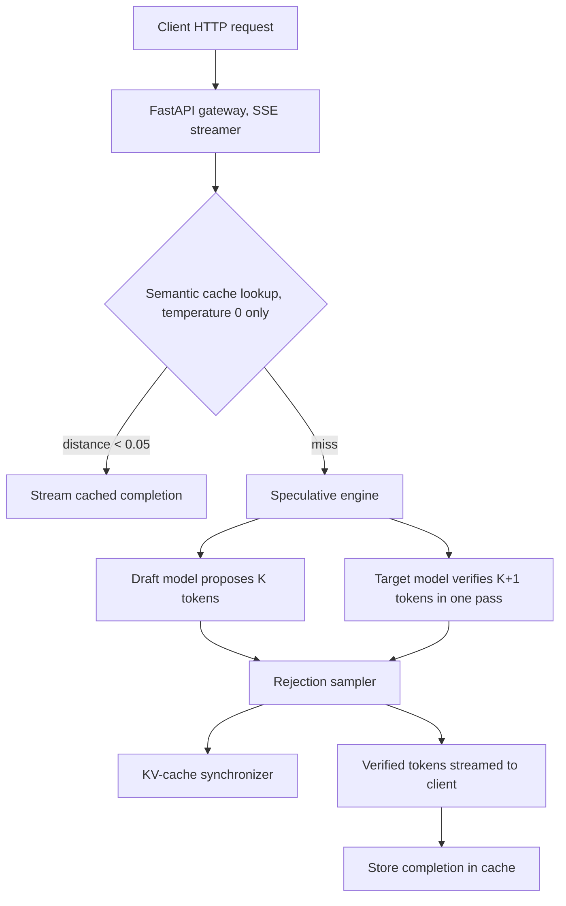

# SpecInfer-Engine

High-throughput **speculative decoding** engine with an **OpenAI-compatible proxy** and a **semantic vector cache**, written from scratch in PyTorch (CPU, tested) with an MLX backend for Apple Silicon (written, **untested**).

## Contents
1. [Purpose](#1-purpose)
2. [Background and mathematics](#2-background-and-mathematics)
3. [Architecture](#3-architecture)
4. [Implementation details](#4-implementation-details)
5. [Repository layout](#5-repository-layout)
6. [Setup and usage](#6-setup-and-usage)
7. [API](#7-api)
8. [Configuration](#8-configuration)
9. [Testing](#9-testing)
10. [Benchmark methodology and results](#10-benchmark-methodology-and-results)
11. [Limitations and honest notes](#11-limitations-and-honest-notes)
12. [Memory budget for the Apple Silicon target](#12-memory-budget-for-the-apple-silicon-target)
13. [Design FAQ](#13-design-faq)

---

## 1. Purpose

Autoregressive LLM decoding is memory-bandwidth bound: each new token requires streaming all model weights from memory, so large models decode slowly even when compute is idle. Speculative decoding attacks this by letting a small **draft** model propose several tokens that a large **target** model then verifies in a *single* forward pass. With modified rejection sampling, the output distribution is **exactly** the target model's, so quality is not traded for speed.

This project implements:
- the speculative decoding loop with exact (unbiased) rejection sampling, and a baseline decoder for comparison;
- KV-cache synchronization between draft and target, including rollback on rejection;
- a semantic cache (embedded Qdrant, cosine distance) that short-circuits near-duplicate prompts;
- an OpenAI-compatible streaming (SSE) HTTP gateway;
- a HumanEval benchmark measuring acceptance rate, throughput, speedup and pass@1.

The goal is a clear, tested reference implementation, not a production serving stack (no batching across requests, single generation in flight).

---

## 2. Background and mathematics

### 2.1 Why decoding is memory-bound
- **Prefill** processes N prompt tokens in parallel: FLOPs scale with N while weights are read once, so arithmetic intensity (FLOPs/byte) is high and the pass is compute-bound.
- **Decode** emits one token per pass: the same weights are read for about one token of work, so intensity is about 1 FLOP/byte and throughput is limited by memory bandwidth. A 32B model at FP16 (64 GB) needs 64 GB of traffic per token; at 4-bit about 18 GB.

Verifying K+1 tokens in one pass reads the weights once, which amortizes the dominant cost *when decode is bandwidth-bound*.

### 2.2 Speculative decoding algorithm
Let the draft model be M_D and the target M_T. Given context x_<t:

1. M_D autoregressively samples K tokens x_1..x_K, with draft distributions q_i(.) = P_MD(. | x_<i).
2. M_T runs **one** forward pass on [last committed token, x_1..x_K], producing target distributions p_1..p_{K+1}, where p_i is the target's distribution at the position where x_i was drafted and p_{K+1} is the "bonus" position after x_K.
3. For i = 1..K, sequentially:
   - Acceptance probability: `a_i = min(1, p_i(x_i) / q_i(x_i))`.
   - Draw `u_i ~ U(0,1)`. If `u_i <= a_i` accept x_i and continue.
   - Otherwise **reject**: discard x_i..x_K, resample one token from the residual distribution

     `p'_i(x) = max(0, p_i(x) - q_i(x)) / sum_y max(0, p_i(y) - q_i(y))`

     and stop.
4. If all K are accepted, sample one extra bonus token from p_{K+1}.

Each cycle therefore emits between 1 and K+1 tokens while costing K draft steps plus one target pass.

### 2.3 Proof that the output distribution equals the target
Consider a single position with draft distribution q and target distribution p. The probability that the emitted token equals x is the sum of the "accepted" and "rejected then resampled" paths.

Accepted path: the draft proposes x with probability q(x), then it is accepted with probability min(1, p(x)/q(x)):

`P_acc(x) = q(x) * min(1, p(x)/q(x)) = min(q(x), p(x))`

Total acceptance probability: `beta = sum_y min(q(y), p(y))`, so the rejection probability is `1 - beta`.

Residual path: on rejection we sample from p'(x) = max(0, p(x) - q(x)) / Z. The normalizer is

`Z = sum_y max(0, p(y) - q(y)) = sum_y (p(y) - min(p(y), q(y))) = 1 - beta`

Therefore:

`P_rej(x) = (1 - beta) * max(0, p(x) - q(x)) / (1 - beta) = max(0, p(x) - q(x))`

Total:

`P(x) = min(q(x), p(x)) + max(0, p(x) - q(x)) = p(x)`

since for any pair, `min(q,p) + max(0, p-q) = p`. So each emitted token is distributed exactly as p. Because later positions are only reached conditional on earlier acceptance, and each step's emitted token has the correct conditional distribution given the committed prefix, induction over positions gives that the whole sequence is distributed as the target's autoregressive distribution. The bonus token is a plain sample from p_{K+1} given the fully accepted prefix, which is also exact.

**Requirement:** p and q must be the distributions actually *sampled from*, i.e. after identical temperature and top-p processing applied to both models. This codebase applies `logits_to_probs` with the same settings to both.

**Greedy special case (temperature 0):** p and q become one-hot at the argmax tokens. A draft token is accepted iff it equals the target's argmax; otherwise the residual is a one-hot at the target argmax. Speculative output is then *token-for-token identical* to baseline greedy decoding, which makes a strong end-to-end correctness test.

### 2.4 Expected speedup
Let alpha be the per-token acceptance probability (assumed i.i.d.), K the lookahead, and c = c_D / c_T the cost ratio of one draft step to one target pass (decode step).

Expected tokens emitted per cycle (a truncated geometric series, counting the resampled/bonus token):

`E[tokens] = 1 + alpha + alpha^2 + ... + alpha^K = (1 - alpha^(K+1)) / (1 - alpha)`   (alpha < 1; equals K+1 when alpha = 1)

Cost per cycle: `K * c_D + c_T` (one verification pass of K+1 tokens is assumed to cost about one target step, which holds only when memory-bound). In units of c_T:

`Speedup S = (1 - alpha^(K+1)) / ((1 - alpha) * (K*c + 1))`

This is the formula used in `bench/humaneval.py` (`theoretical_speedup`). A simpler approximation, `(1 + alpha*K) / (c*K + 1)`, appears in many write-ups; it is a linearization and slightly overestimates for alpha near 1 only through different weighting, so the exact geometric form is used here.

Worked example: alpha = 0.9, K = 4, c = 0.33: E[tokens] = (1 - 0.9^5)/0.1 = 4.095; cost = 4*0.33 + 1 = 2.32; S = 1.76x.

**Key caveat:** the model assumes verification of K+1 tokens costs about the same as one token. That is true when decode is bandwidth-bound (large target, Apple Silicon/GPU) and false on a compute-bound CPU with a small target, where verifying K+1 tokens costs noticeably more than one. See [results](#10-benchmark-methodology-and-results).

### 2.5 Semantic cache distance
Prompts are embedded to unit vectors; cosine distance is

`d(a, b) = 1 - (a . b) / (||a|| ||b||)`

A cached completion is returned when the nearest neighbor has `d < 0.05` (default). Qdrant reports cosine *similarity* as its score, so the code uses `d = 1 - score`.

---

## 3. Architecture



### Components
| Component | File | Responsibility |
| :-- | :-- | :-- |
| Gateway | `server/app.py`, `server/routes.py` | `/v1/chat/completions` (stream and non-stream), `/health`, `/metrics` |
| Semantic cache | `cache/vector_cache.py`, `cache/embeddings.py` | Embedded Qdrant collection with cosine distance; nomic-embed-text (MiniLM fallback) |
| Service | `engine/service.py` | Chat templating, single-flight lock, incremental detokenization, metrics |
| Speculative loop | `engine/speculative.py` | `speculative_generate`, `baseline_generate`, `GenStats` |
| Rejection sampler | `engine/sampler.py` | `logits_to_probs`, `rejection_sample` (tensorized) |
| KV synchronizer | `engine/kv_cache.py` | Keeps draft and target caches aligned, rollback on rejection |
| Backends | `engine/model_loader.py`, `engine/mlx_backend.py` | `ModelBackend` interface; `HFBackend` (tested), `MLXBackend` (untested) |

---

## 4. Implementation details

### 4.1 Backend interface
```
forward(tokens) -> logits [len(tokens), V]   # appends tokens to the internal KV cache
truncate(n)                                  # keep exactly n cached positions
reset()                                      # clear cache
length                                       # cached positions
```
The engine only talks to this interface, so the sampler, cache and server are backend-agnostic.

### 4.2 Cache invariant and one speculative cycle
Between cycles, with `seq` = prompt + committed tokens, **both KV caches hold exactly `seq[:-1]`**; the last committed token is the pending input of the next cycle. Let `base = len(seq) - 1`.

1. **Draft:** feed `[last]`, sample d_1; feed d_1, sample d_2; ... K tokens. Draft cache length = `base + K` (d_K is sampled but never fed). Record each q_i.
2. **Verify:** target forward on `[last, d_1..d_K]` gives K+1 logit rows (row i predicts the token after position i). Target cache length = `base + K + 1`.
3. **Sample:** `rejection_sample` returns `(n, next_token)`, where n is the accepted prefix length.
4. **Commit** (`KVCacheSynchronizer.commit`), new cache length `L = base + n + 1`:
   - target: truncate to L (keeps `last, d_1..d_n`);
   - draft: if `n == K`, feed d_K (it was never cached) so length becomes `base + K + 1 = L`; otherwise truncate to L.
5. Emit `d_1..d_n, next_token`; the new last committed token is `next_token`, and the invariant holds again. The synchronizer asserts both lengths are equal.

The final emitted list is trimmed at the first EOS token and at the `max_new_tokens` budget (the bonus token can otherwise exceed it by one).

### 4.3 Tensorized rejection sampler
`rejection_sample(draft_tokens[K], q[K,V], p[K+1,V])`:
- `ratio = p[i, x_i] / q[i, x_i]`, accept mask `u <= min(1, ratio)`;
- accepted prefix length `n = cumprod(accept).sum()` (the cumulative product zeroes everything after the first rejection);
- if `n == K`: sample the bonus token from `p[K]`;
- else sample from `normalize(max(0, p[n] - q[n]))`, falling back to `p[n]` if the residual mass is zero.

`logits_to_probs` applies temperature (0 gives a one-hot greedy distribution) and top-p, and is used identically for draft and target.

### 4.4 Semantic cache policy
Only **temperature-0** requests are cached or served from cache; sampled requests are intentionally non-deterministic and must not be replayed. The cache key is the concatenated `role: content` of the messages. Lookups embed the prompt, query Qdrant for the top-1 neighbor, and hit when `1 - score < threshold`. Completions are stored after a successful miss. Storage is embedded Qdrant on disk (`data/cache_store`), or in memory in tests.

### 4.5 Serving
- The route handlers are synchronous; FastAPI/Starlette run the blocking generation in a worker thread, so the event loop stays free.
- Streaming uses SSE chunks in the OpenAI `chat.completion.chunk` format, ending with `data: [DONE]`.
- A lock makes generation single-flight (one request uses the models at a time).
- Detokenization is incremental: the full ids are decoded each step and only the new suffix is sent; output ending in an incomplete UTF-8 character (`\ufffd`) is held back until completed.

---

## 5. Repository layout
```
src/specinfer/
  config.py                 # pydantic settings (SPECINFER_* env vars)
  cache/{embeddings,vector_cache}.py
  engine/{sampler,speculative,kv_cache,model_loader,mlx_backend,service,cli}.py
  server/{app,routes}.py
bench/humaneval.py          # baseline vs speculative benchmark + pass@1
tests/unit, tests/integration
docs/architecture_spec.md, docs/bench_results.json, docs/bench.log
.github/workflows/ci.yml    # ruff, mypy, pytest (non-slow)
```

---

## 6. Setup and usage
```bash
python -m venv .venv && . .venv/bin/activate
pip install torch --index-url https://download.pytorch.org/whl/cpu
pip install -e ".[dev]"

pytest -m "not slow"                                  # fast unit tests, no downloads
pytest -m slow                                        # real-model equivalence test (downloads models)

python -m specinfer.engine.sampler --mode baseline    # single-prompt baseline
python -m specinfer.engine.sampler --mode speculative # single-prompt speculative
python bench/humaneval.py --n 12 --max-new 200 --k 4  # benchmark
python -m specinfer.server.app                        # gateway on 127.0.0.1:8000
```
Models (Qwen2.5-0.5B-Instruct and Qwen2.5-1.5B-Instruct, about 4 GB total) are downloaded from Hugging Face on first use. Set `HF_HOME` to choose where they are stored; `tests/conftest.py` uses a project-local `.hf/` if it exists.

**Apple Silicon (MLX, untested):**
```bash
pip install -e ".[mlx]"
export SPECINFER_BACKEND=mlx
export SPECINFER_DRAFT_MODEL=mlx-community/Qwen2.5-0.5B-Instruct-4bit
export SPECINFER_TARGET_MODEL=mlx-community/Qwen2.5-32B-Instruct-4bit
python -m specinfer.server.app
```
The MLX backend implements the same interface via `mlx_lm` prompt caches (`trim_prompt_cache` for rollback). It has not been run; expect to debug it on first use.

---

## 7. API
```bash
curl localhost:8000/v1/chat/completions -H 'content-type: application/json' -d '{
  "messages": [{"role": "user", "content": "Write a one-line python lambda to square x."}],
  "max_tokens": 64, "temperature": 0, "stream": false
}'
```
Request fields: `messages`, `temperature` (default 0), `top_p`, `max_tokens` (default 256), `stream`, `seed`. `GET /health` returns status; `GET /metrics` returns requests, cache hits, tokens, acceptance rate and tokens/sec.

Smoke test on the real models (CPU): first request 4.5 s, identical second request served from the cache in 12 ms.

---

## 8. Configuration
Environment variables with the `SPECINFER_` prefix (see `config.py`):

| Variable | Default | Meaning |
| :-- | :-- | :-- |
| `BACKEND` | `hf` | `hf` or `mlx` |
| `DRAFT_MODEL` | `Qwen/Qwen2.5-0.5B-Instruct` | draft model id |
| `TARGET_MODEL` | `Qwen/Qwen2.5-1.5B-Instruct` | target model id |
| `LOOKAHEAD_K` | `4` | draft tokens per cycle |
| `CACHE_ENABLED` | `true` | semantic cache on/off |
| `CACHE_PATH` | `data/cache_store` | Qdrant storage dir |
| `CACHE_DISTANCE_THRESHOLD` | `0.05` | max cosine distance for a hit |
| `EMBED_MODEL` | `nomic-ai/nomic-embed-text-v1.5` | embedder (falls back to MiniLM if it cannot load) |
| `HOST`, `PORT` | `127.0.0.1`, `8000` | server bind |

---

## 9. Testing
| Test | What it proves |
| :-- | :-- |
| `unit/test_rejection_sampler.py` | Chi-square test (40k trials) that the emitted token follows the target p even though tokens are drafted from q; all-accept when q = p; all-reject with disjoint support; greedy and top-p transforms |
| `unit/test_kv_sync.py` | With a deterministic fake LM: greedy speculative output equals baseline; draft and target cache lengths stay synchronized under sampling; the max-token budget is respected |
| `unit/test_vector_cache.py` | Cache hit/miss at the distance threshold, and persistence on disk |
| `unit/test_server.py` | Non-stream and SSE responses, cache hit skips generation, sampled requests bypass the cache |
| `integration/test_speculative_stream.py` (slow) | Real Qwen models: greedy speculative output matches baseline |

CI (`.github/workflows/ci.yml`) runs ruff, mypy and the non-slow tests. All pass locally.

---

## 10. Benchmark methodology and results

**Setup:** first 12 problems of `openai/openai_humaneval`; greedy decoding; max 200 new tokens; K = 4; draft Qwen2.5-0.5B-Instruct, target Qwen2.5-1.5B-Instruct; fp32 on a 12-thread Linux CPU (no GPU). Each problem is run in both modes. Generated code is extracted from the response and executed against the HumanEval tests in a subprocess with a 20 s timeout to compute pass@1.

**Metrics:** acceptance rate = accepted draft tokens / drafted tokens; throughput = emitted tokens / wall time; speedup = speculative throughput / baseline throughput; pass@1 on the 12 problems.

| Mode | Throughput | Speedup | Pass@1 | Acceptance |
| :-- | :-- | :-- | :-- | :-- |
| Baseline (1.5B) | 4.43 tok/s | 1.00x | 75% (9/12) | n/a |
| Speculative (0.5B draft, K=4) | 4.40 tok/s | 0.99x | 75% (9/12) | 91.6% |

- Greedy outputs were **identical to baseline on 12/12** problems, matching the theory in section 2.3.
- The theoretical speedup from the formula in 2.4 at alpha = 0.916, K = 4, c = 0.33 is about 1.82x. The measured 0.99x is lower because verifying 5 tokens on a compute-bound CPU costs more than one decode step, and because 0.5B vs 1.5B is only about a 3x cost ratio.
- With only 12 problems, pass@1 is a parity check, not a statistically meaningful accuracy estimate. Raw numbers: `docs/bench_results.json`, log: `docs/bench.log`.

---

## 11. Limitations and honest notes
- **No speedup was achieved on this CPU.** The speedup claims in the literature, and the 2.5x to 3.8x range quoted in the original project brief, apply to a bandwidth-bound regime (large target such as 32B on Apple Silicon or a GPU). That regime is **not measured here**.
- The MLX backend and the 32B/4-bit configuration are **untested**.
- Single request in flight; no continuous batching, no paged KV cache, no tree-structured speculation.
- The theoretical formula assumes i.i.d. acceptance and verification cost equal to one decode step.
- Semantic caching trades exactness for latency: a near-duplicate prompt (distance < 0.05) may be answered with the completion for a slightly different prompt. It is limited to temperature 0.
- The benchmark is small (12 problems) because of CPU time.

---

## 12. Memory budget for the Apple Silicon target
Estimates from the original design (not measured here), 48 GB unified memory:

| Item | Size |
| :-- | :-- |
| Draft Qwen2.5-0.5B, 4-bit | about 0.35 GB |
| Target Qwen2.5-32B, 4-bit | about 18.2 GB |
| Dual KV cache, 8192 context | about 3.8 GB |
| Semantic index | about 0.5 GB |
| Total static | about 22.85 GB |

Bandwidth reasoning: at 4-bit, about 18 GB of weights are read per decode step, so a 400 GB/s machine is capped near 22 tok/s for baseline decoding; verifying K tokens per weight read is what raises the ceiling.

---

## 13. Design FAQ
**How is quality guaranteed not to degrade?** By the rejection-sampling argument in 2.3: the marginal of every emitted token equals the target's processed distribution, and greedy mode is exactly baseline output (verified on 12/12 problems).

**Why can speculative decoding be faster on unified-memory machines?** Decode is limited by bytes moved per token. One verification pass reads the target weights once and checks K+1 positions, converting several memory-bound steps into one pass with higher arithmetic intensity.

**What happens to the KV caches on rejection at position n?** Draft tokens from the rejected one onward are discarded: the target cache is truncated to `base + n + 1` positions and the draft cache is truncated (or advanced by d_K when everything is accepted) to the same length, so both stay aligned without recomputing the prefix.
